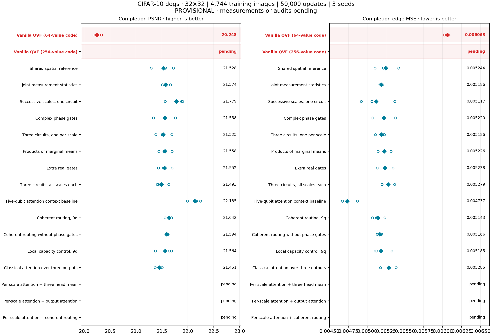
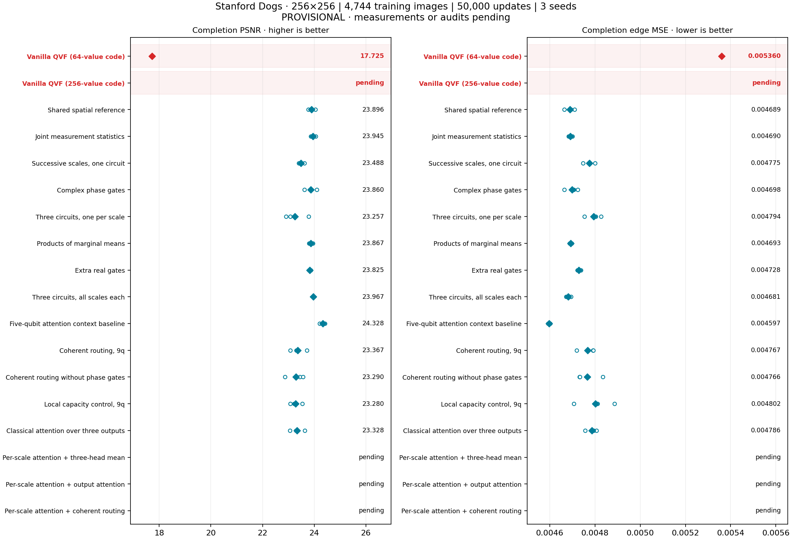

# Z10: larger-code vanilla QVF control

Status: in progress; no complete comparison yet.
Both plots include all18 methods. The64-value and256-value vanilla QVF controls are red; the latter uses a triangle for its complete three-seed mean. Missing measurements stay pending.

The new arm uses the original QVFImage with256 learned global code entries instead of64. Its five qubits, five repetitions, all-to-all controlled rotations, amplitude output size32, three128-wide hidden layers and fixed RGB measurement map are unchanged. The widened input adds24,576 classical first-layer weights. All runs start fresh.

Within each dataset, images,50,000 training updates, three seeds, coordinate streams, Adam settings, RGB-plus-edge objective and1,000-step frozen-decoder code fits are unchanged. The original initializer is used at each width, so paired seed labels do not imply identical shared initial tensors. Code initialization standard deviation and the L2-norm penalty coefficient are unchanged; expected norms depend on dimension.

This tests a larger global code, including its larger MLP input. It does not equalize representation storage or classical compute: spatial methods still use336 entries at32px and21,504 at256px. The two panels use different datasets. Prior test results informed this extension, so it is not a new confirmatory holdout.

The18 Z9 per-scale-attention runs continue unchanged. Z10 waits for that complete pipeline before training its six new runs on GPU0. The combined report reuses earlier runs and marks unmeasured rows pending.

## cifar32

| Method | Seeds | Completion PSNR | Completion edge MSE |
|---|---:|---:|---:|
| Vanilla QVF (64-value code) | 3/3 | 20.248 | 0.0060632 |
| Vanilla QVF (256-value code) | 0/3 | pending | pending |
| Shared spatial reference | 3/3 | 21.528 | 0.0052438 |
| Joint measurement statistics | 3/3 | 21.574 | 0.0051862 |
| Successive scales, one circuit | 3/3 | 21.779 | 0.0051166 |
| Complex phase gates | 3/3 | 21.558 | 0.0052204 |
| Three circuits, one per scale | 3/3 | 21.525 | 0.0051862 |
| Products of marginal means | 3/3 | 21.558 | 0.0052260 |
| Extra real gates | 3/3 | 21.552 | 0.0052378 |
| Three circuits, all scales each | 3/3 | 21.493 | 0.0052786 |
| Five-qubit attention context baseline | 3/3 | 22.135 | 0.0047367 |
| Coherent routing, 9q | 3/3 | 21.642 | 0.0051428 |
| Coherent routing without phase gates | 3/3 | 21.594 | 0.0051659 |
| Local capacity control, 9q | 3/3 | 21.564 | 0.0051854 |
| Classical attention over three outputs | 3/3 | 21.451 | 0.0052846 |
| Per-scale attention + three-head mean | 0/3 | pending | pending |
| Per-scale attention + output attention | 0/3 | pending | pending |
| Per-scale attention + coherent routing | 0/3 | pending | pending |

## dogs256

| Method | Seeds | Completion PSNR | Completion edge MSE |
|---|---:|---:|---:|
| Vanilla QVF (64-value code) | 3/3 | 17.725 | 0.0053599 |
| Vanilla QVF (256-value code) | 0/3 | pending | pending |
| Shared spatial reference | 3/3 | 23.896 | 0.0046893 |
| Joint measurement statistics | 3/3 | 23.945 | 0.0046901 |
| Successive scales, one circuit | 3/3 | 23.488 | 0.0047747 |
| Complex phase gates | 3/3 | 23.860 | 0.0046983 |
| Three circuits, one per scale | 3/3 | 23.257 | 0.0047944 |
| Products of marginal means | 3/3 | 23.867 | 0.0046929 |
| Extra real gates | 3/3 | 23.825 | 0.0047278 |
| Three circuits, all scales each | 3/3 | 23.967 | 0.0046812 |
| Five-qubit attention context baseline | 3/3 | 24.328 | 0.0045974 |
| Coherent routing, 9q | 3/3 | 23.367 | 0.0047673 |
| Coherent routing without phase gates | 3/3 | 23.290 | 0.0047665 |
| Local capacity control, 9q | 3/3 | 23.280 | 0.0048016 |
| Classical attention over three outputs | 3/3 | 23.328 | 0.0047858 |
| Per-scale attention + three-head mean | 0/3 | pending | pending |
| Per-scale attention + output attention | 0/3 | pending | pending |
| Per-scale attention + coherent routing | 0/3 | pending | pending |

Source data,per-seed values, arithmetic mean pixel MSE, paired differences versus QVF64 and planned code-size contrasts are in`comparison.json`. Final completion requires independent checkpoint/metric checks and native quantum/measurement audits. No hardware or quantum-advantage claim.
