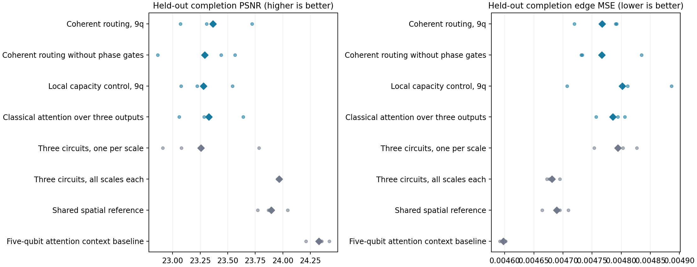
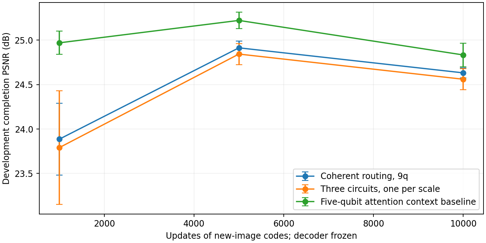

# Z7: coherent routing benchmark against Z6

Four new conditions were trained from scratch with three paired seeds. Data, updates, queried coordinates, losses, code budgets and primary evaluation are matched to the completed Z6 study. Z6 scores are reused from verified artifacts; those models were not retrained.

| Model | Training probe PSNR | New-image full-fit PSNR | Completion PSNR | Completion edge MSE |
|---|---:|---:|---:|---:|
| Coherent routing, 9q | 26.250 | 24.120 | 23.367 | 0.0047673 |
| Coherent routing without phase gates | 26.305 | 24.150 | 23.290 | 0.0047665 |
| Local capacity control, 9q | 26.324 | 24.112 | 23.280 | 0.0048016 |
| Classical attention over three outputs | 26.091 | 24.085 | 23.328 | 0.0047858 |
| Shared spatial reference | 26.103 | 24.989 | 23.896 | 0.0046893 |
| Joint measurement statistics | 26.212 | 25.068 | 23.945 | 0.0046901 |
| Successive scales, one circuit | 26.187 | 24.310 | 23.488 | 0.0047747 |
| Complex phase gates | 26.239 | 24.942 | 23.860 | 0.0046983 |
| Three circuits, one per scale | 26.301 | 24.101 | 23.257 | 0.0047944 |
| Products of marginal means | 26.227 | 24.946 | 23.867 | 0.0046929 |
| Extra real gates | 26.182 | 24.967 | 23.825 | 0.0047278 |
| Three circuits, all scales each | 26.392 | 25.095 | 23.967 | 0.0046812 |
| Five-qubit attention context baseline | 27.163 | 25.397 | 24.328 | 0.0045974 |

Values are three-seed means. Paired differences and sample SDs are saved in `comparison.json`; three seeds do not establish broad statistical significance.

## Paired completion comparisons

- Coherent routing versus Coherent routing without phase gates: +0.077dB; higher PSNR in 2/3 seeds.
- Coherent routing versus Local capacity control, 9q: +0.087dB; higher PSNR in 1/3 seeds.
- Coherent routing versus Classical attention over three outputs: +0.038dB; higher PSNR in 1/3 seeds.
- Coherent routing versus Three circuits, one per scale: +0.109dB; higher PSNR in 2/3 seeds.
- Coherent routing versus Three circuits, all scales each: -0.600dB; higher PSNR in 0/3 seeds.
- Coherent routing versus Shared spatial reference: -0.529dB; higher PSNR in 0/3 seeds.
- Coherent routing versus Five-qubit attention context baseline: -0.962dB; higher PSNR in 0/3 seeds.
- Coherent routing versus Joint measurement statistics: -0.579dB; higher PSNR in 0/3 seeds.

## Interpretation and limits

- No hardware experiment or quantum advantage claim.
- 256px targets are centre crops downsampled from originals with both dimensions >=256; no upsampling.
- Training reconstruction metrics use a predeclared 256-image probe, not all 4744 images.
- Dataset, latent budget, coordinate budget and positional frequencies differ from Z5; raw metrics are not a controlled resolution ablation.
- New-image codes are optimized with a frozen field; no learned encoder.
- Same 50000 updates and sampled coordinates; no equal wall-clock or equal total quantum-query claim.
- 2048 coordinate endpoints/image/update: approximately 5.27 pixel presentations per training pixel on average, not 50000 full-image passes.
- Original Stanford server unavailable: pinned mirror split membership not independently checked against original MATLAB files.
- Exact selected image duplicates removed; near duplicates not independently excluded.
- Z6 test scores were inspected before Z7 design. This is reuse of a benchmark, not a previously unseen confirmatory test set.
- All four variants are freshly trained; no Z6 weights/codes are used for initialization.
- Stored total parameters match except real_routing freezes eight phase entries; independence of all parameter entries is not claimed.
- The classical 16-parameter softmax gate is output fusion, not feedback or attention over grid cells.
- Nine-qubit coherent variants are multiplexed branches, not three independent seven-qubit registers.
- Synthetic gate-noise scope is four test images x 32 common withheld coordinates, seed0 only; Z6 references are rechecked on that same subset.
- Finite-shot classical softmax fusion is nonlinear; its expected loss is estimated by measurement replicates, not the linear readout formula.
- Coherence-removal checks use a tiny trained-checkpoint diagnostic; the dephased model is not separately retrained.
- No hardware execution, quantum advantage, or research-novelty claim.

- Longer code-fitting curves use development images only. The primary test comparison retains 1,000 updates. A recovery after longer fitting supports an optimization-budget explanation; it is not proof that a decoder has unlimited capacity.
- Local-capacity control has the same nine-qubit register and 16 extra trainable quantum parameters but no non-additive communication between scales. Its primitive gate count differs. Classical attention has 16 extra stored classical parameters and three independent seven-qubit circuits.
- Circuit coherence diagnostics establish sensitivity to coherence for the trained model, not an advantage over classical computation or over a separately retrained dephased model.
- Quantum circuits, gradients, fresh initializations, source/checkpoint hashes, training/query streams and independent reconstruction metrics have been checked. Noise is synthetic and excludes physical routing.

