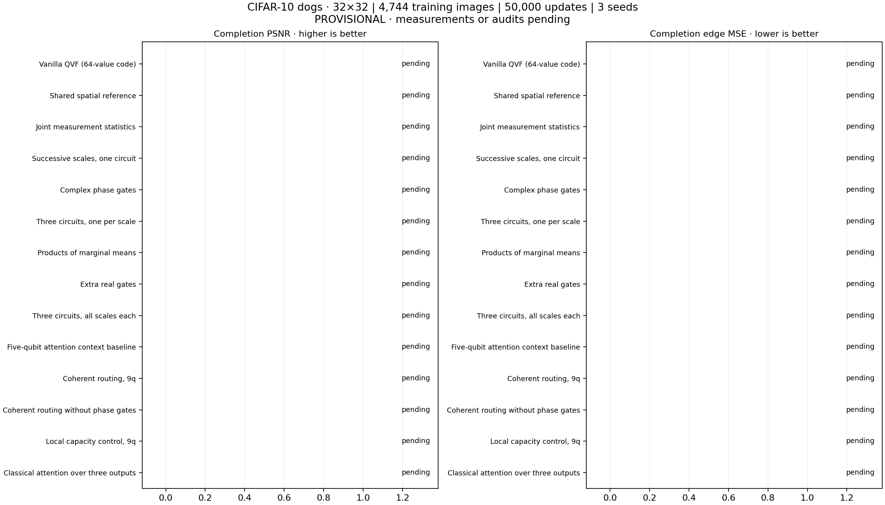
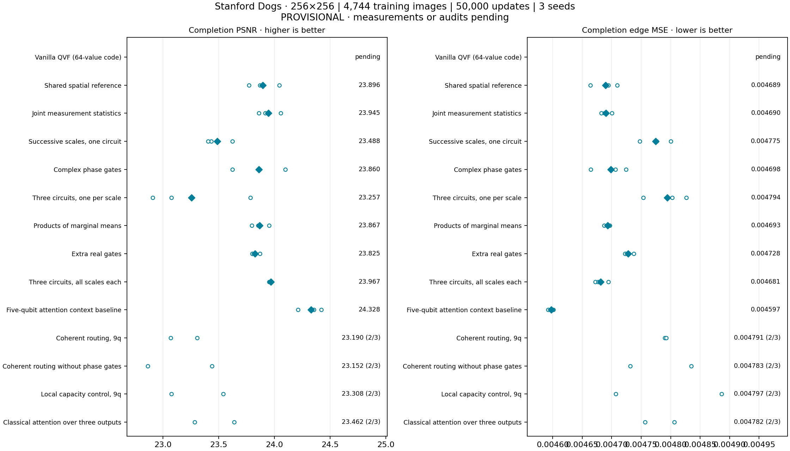

# Z8: complete QVF-method comparison

Status: in progress; no complete comparison yet.
Both plots include the same14 methods. Pending entries are measurements not yet completed; no historical scores substitute for missing runs.

Within each dataset, all methods use the same images,50,000 updates,paired seeds,queries,RGB-plus-edge objective and1,000-step frozen-decoder evaluation. Vanilla QVF keeps its original5q circuit,amplitude map,RGB readout and64-value code. The training recipe is matched to Z,not a replay of the paper training schedule.

Spatial codes contain336 values at32px and21,504 at256px. This is a comparison of architecture packages,not an equal-storage or equal-compute ablation. The two datasets differ; do not interpret cross-panel score changes as a resolution-only effect.

## cifar32

| Method | Seeds | Completion PSNR | Completion edge MSE |
|---|---:|---:|---:|
| Vanilla QVF (64-value code) | 0/3 | pending | pending |
| Shared spatial reference | 0/3 | pending | pending |
| Joint measurement statistics | 0/3 | pending | pending |
| Successive scales, one circuit | 0/3 | pending | pending |
| Complex phase gates | 0/3 | pending | pending |
| Three circuits, one per scale | 0/3 | pending | pending |
| Products of marginal means | 0/3 | pending | pending |
| Extra real gates | 0/3 | pending | pending |
| Three circuits, all scales each | 0/3 | pending | pending |
| Five-qubit attention context baseline | 0/3 | pending | pending |
| Coherent routing, 9q | 0/3 | pending | pending |
| Coherent routing without phase gates | 0/3 | pending | pending |
| Local capacity control, 9q | 0/3 | pending | pending |
| Classical attention over three outputs | 0/3 | pending | pending |

## dogs256

| Method | Seeds | Completion PSNR | Completion edge MSE |
|---|---:|---:|---:|
| Vanilla QVF (64-value code) | 0/3 | pending | pending |
| Shared spatial reference | 3/3 | 23.896 | 0.0046893 |
| Joint measurement statistics | 3/3 | 23.945 | 0.0046901 |
| Successive scales, one circuit | 3/3 | 23.488 | 0.0047747 |
| Complex phase gates | 3/3 | 23.860 | 0.0046983 |
| Three circuits, one per scale | 3/3 | 23.257 | 0.0047944 |
| Products of marginal means | 3/3 | 23.867 | 0.0046929 |
| Extra real gates | 3/3 | 23.825 | 0.0047278 |
| Three circuits, all scales each | 3/3 | 23.967 | 0.0046812 |
| Five-qubit attention context baseline | 3/3 | 24.328 | 0.0045974 |
| Coherent routing, 9q | 2/3 | 23.190 | 0.0047913 |
| Coherent routing without phase gates | 2/3 | 23.152 | 0.0047832 |
| Local capacity control, 9q | 2/3 | 23.308 | 0.0047968 |
| Classical attention over three outputs | 2/3 | 23.462 | 0.0047816 |

Source data,per-seed values and paired differences versus vanilla QVF are in`comparison.json`. Final completion requires independent checkpoint/metric checks and native quantum/measurement audits. No hardware or quantum-advantage claim.
