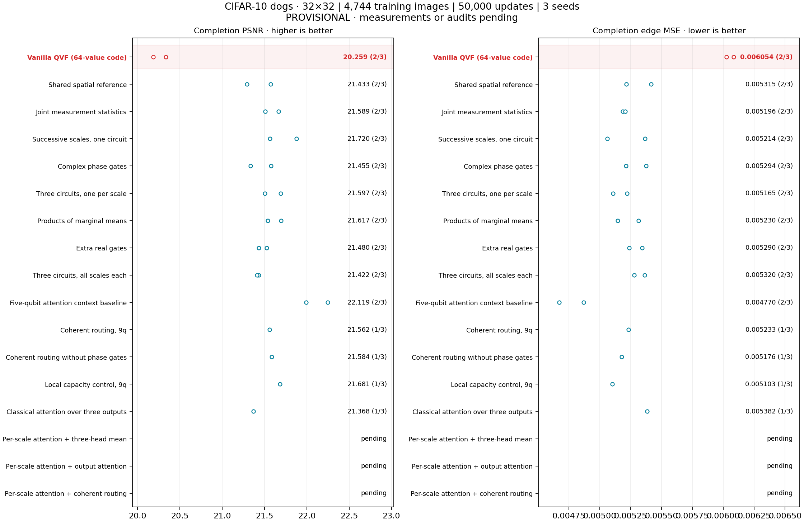
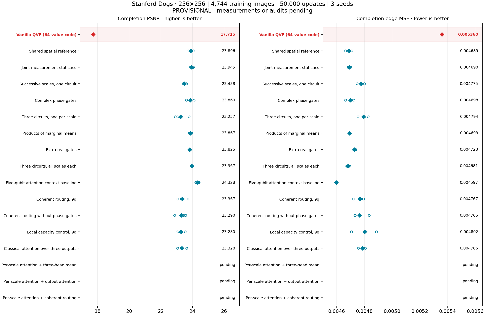

# Z9: full per-scale attention and quantum-circuit combination

Status: in progress; no complete comparison yet.
Both plots include the same17 methods. Pending entries are measurements not yet completed; no historical scores substitute for missing runs.

Within each dataset, all methods use the same images,50,000 updates,paired seeds,queries,RGB-plus-edge objective and1,000-step frozen-decoder evaluation. Vanilla QVF keeps its original5q circuit,amplitude map,RGB readout and64-value code. The training recipe is matched to Z,not a replay of the paper training schedule.

Spatial codes contain336 values at32px and21,504 at256px. This is a comparison of architecture packages,not an equal-storage or equal-compute ablation. The two datasets differ; do not interpret cross-panel score changes as a resolution-only effect.

The three added models use classical attention within a bounded5x5-token window around each of five spatial input slots, independently at every scale. Their attention front ends, spatial code budgets, data-angle encoding and branch circuit parameters start identically. Their fusion differs: mean of three7q outputs;16-parameter classical output attention; or the existing9q coherent scale-routing circuit.

The per-scale attention mean versus the original separate-scale model isolates replacing interpolation with learned attention, including its added classical parameters. The old5q attention baseline uses dense attention, amplitude encoding and a different circuit; its comparison is not a circuit-count-only test. Independent7q heads do not share a quantum state; the coherent model uses a shared payload and scale address, not three entangled7q registers.

## cifar32

| Method | Seeds | Completion PSNR | Completion edge MSE |
|---|---:|---:|---:|
| Vanilla QVF (64-value code) | 2/3 | 20.259 | 0.0060541 |
| Shared spatial reference | 2/3 | 21.433 | 0.0053148 |
| Joint measurement statistics | 2/3 | 21.589 | 0.0051957 |
| Successive scales, one circuit | 2/3 | 21.720 | 0.0052140 |
| Complex phase gates | 2/3 | 21.455 | 0.0052940 |
| Three circuits, one per scale | 2/3 | 21.597 | 0.0051651 |
| Products of marginal means | 2/3 | 21.617 | 0.0052295 |
| Extra real gates | 2/3 | 21.480 | 0.0052904 |
| Three circuits, all scales each | 2/3 | 21.422 | 0.0053200 |
| Five-qubit attention context baseline | 2/3 | 22.119 | 0.0047703 |
| Coherent routing, 9q | 1/3 | 21.562 | 0.0052329 |
| Coherent routing without phase gates | 1/3 | 21.584 | 0.0051763 |
| Local capacity control, 9q | 1/3 | 21.681 | 0.0051027 |
| Classical attention over three outputs | 1/3 | 21.368 | 0.0053821 |
| Per-scale attention + three-head mean | 0/3 | pending | pending |
| Per-scale attention + output attention | 0/3 | pending | pending |
| Per-scale attention + coherent routing | 0/3 | pending | pending |

## dogs256

| Method | Seeds | Completion PSNR | Completion edge MSE |
|---|---:|---:|---:|
| Vanilla QVF (64-value code) | 3/3 | 17.725 | 0.0053599 |
| Shared spatial reference | 3/3 | 23.896 | 0.0046893 |
| Joint measurement statistics | 3/3 | 23.945 | 0.0046901 |
| Successive scales, one circuit | 3/3 | 23.488 | 0.0047747 |
| Complex phase gates | 3/3 | 23.860 | 0.0046983 |
| Three circuits, one per scale | 3/3 | 23.257 | 0.0047944 |
| Products of marginal means | 3/3 | 23.867 | 0.0046929 |
| Extra real gates | 3/3 | 23.825 | 0.0047278 |
| Three circuits, all scales each | 3/3 | 23.967 | 0.0046812 |
| Five-qubit attention context baseline | 3/3 | 24.328 | 0.0045974 |
| Coherent routing, 9q | 3/3 | 23.367 | 0.0047673 |
| Coherent routing without phase gates | 3/3 | 23.290 | 0.0047665 |
| Local capacity control, 9q | 3/3 | 23.280 | 0.0048016 |
| Classical attention over three outputs | 3/3 | 23.328 | 0.0047858 |
| Per-scale attention + three-head mean | 0/3 | pending | pending |
| Per-scale attention + output attention | 0/3 | pending | pending |
| Per-scale attention + coherent routing | 0/3 | pending | pending |

Source data,per-seed values and paired differences versus vanilla QVF are in`comparison.json`. Final completion requires independent checkpoint/metric checks and native quantum/measurement audits. No hardware or quantum-advantage claim.
